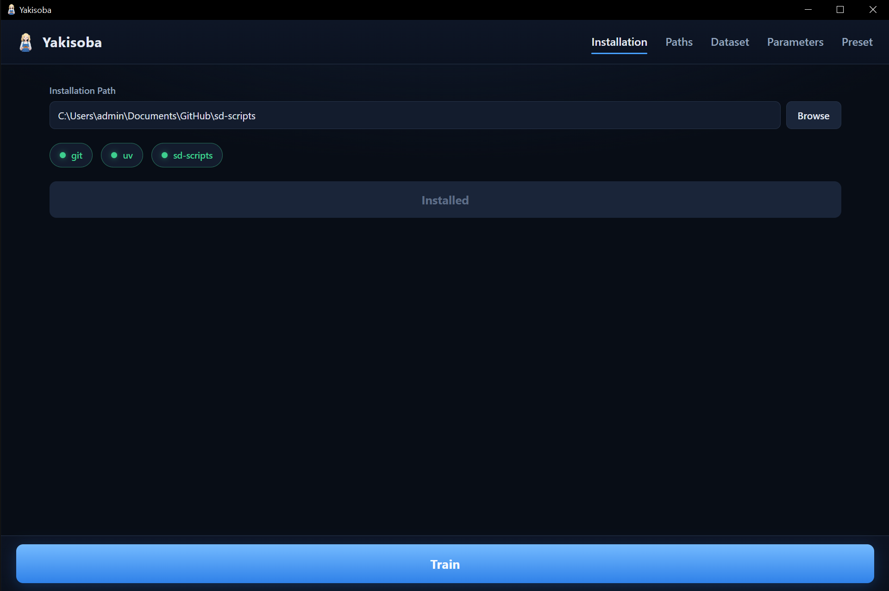
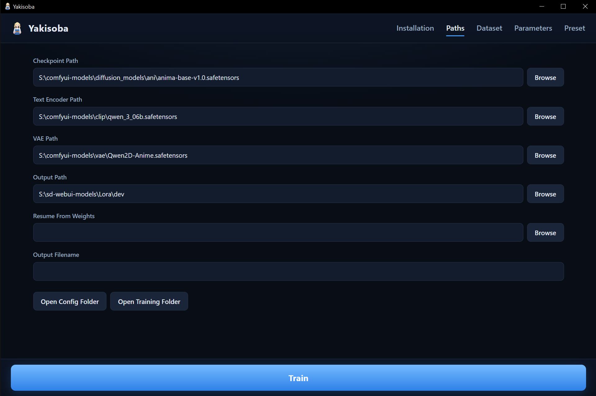
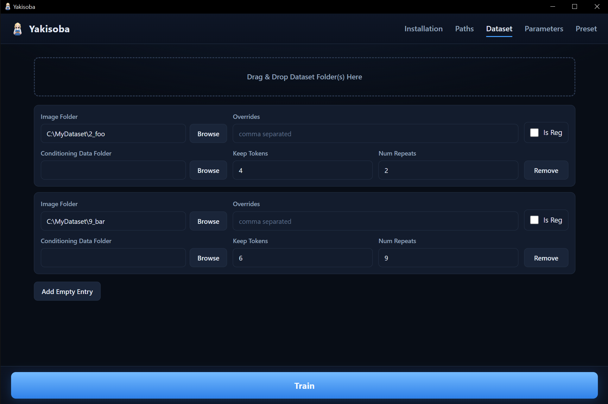
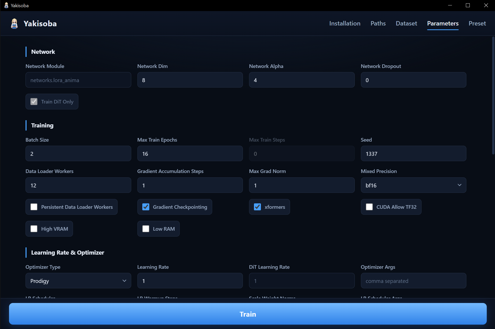
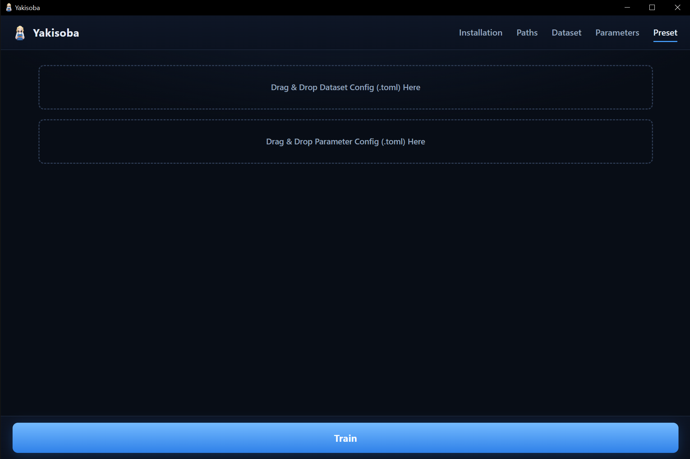

<h1 align="center">Y A K I S O B A</h1>

<p align="center">
<i><b>Y</b>et <b>A</b>nother <b>K</b>ohya-ss <b>I</b>nterconnecting <b>S</b>oftware <b>O</b>ptimized for <b>B</b>aking <b>A</b>nima</i>
<br>
<a href="https://www.rust-lang.org/"></a> 
 
 
 
<a href="https://v2.tauri.app/"></a>
</p>
<p align="right">
<sup><i>this project (excl. README) is <a href="#vibecoding">vibecoded</a></i></sup>
</p>
<p align="center">
 
</p>

<br>

## Features

**Yakisoba** is a GUI wrapper of [sd-scripts](https://github.com/kohya-ss/sd-scripts) to train LoRA for [Anima](https://huggingface.co/circlestone-labs/Anima)

<br>

#### Installation

- Check whether [git](https://git-scm.com/install), [uv](https://github.com/astral-sh/uv#installation), and [sd-scripts](https://github.com/kohya-ss/sd-scripts) are installed
- Automatically `git clone` the repository and `uv pip install` the dependencies

<p align="center">

</p>

#### Paths

- Save the paths to the `Anima`, `Qwen3 0.6B`, `Qwen-Image-VAE` models, as well as the output folder

<p align="center">

</p>

#### Dataset

- Support per-dataset configs
- Support `masked_loss` with `conditioning_data_dir`

<p align="center">

</p>

#### Parameters

- Adjust training parameters

<p align="center">

</p>

#### Preset

- Drop in a past training config to load its parameters

<p align="center">

</p>

<br>

## How to Use

Download the pre-built `.exe` from the [Releases](https://github.com/Haoming02/yakisoba/releases)

## Development

- [Rust](https://rust-lang.org/tools/install/), [Node.js](https://nodejs.org/en/download), [pnpm](https://pnpm.io/installation) are required

```bash
git clone https://github.com/Haoming02/yakisoba
cd yakisoba
pnpm install
pnpm run tauri dev
```

<br><hr><br>

## Vibecoding

Every versioned commit is written by asking the LLM to "`Execute Plan.md`"

<details>
<summary>Environment</summary>

- **OS:** Windows 10
- **GPU:** RTX 4070 Ti S
- **VRAM:** 16 GB
- **RAM:** 96 GB
- **Model:** [Qwen3.8 Flash Next IQ3_XXS](https://huggingface.co/ISTA-DASLab/Qwen3.8-Flash-Next-GSQ-RCO-GGUF/tree/main/IQ3_XXS)
- **Server:** [Strata](https://github.com/niko1221/strata)
- **Agent:** [OpenCode](https://github.com/anomalyco/opencode)
- **Context Length:** 128k

</details>
